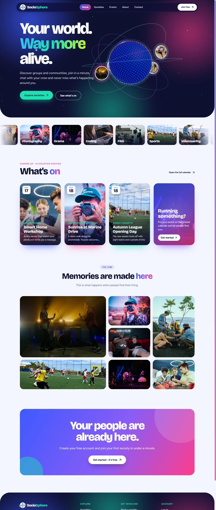
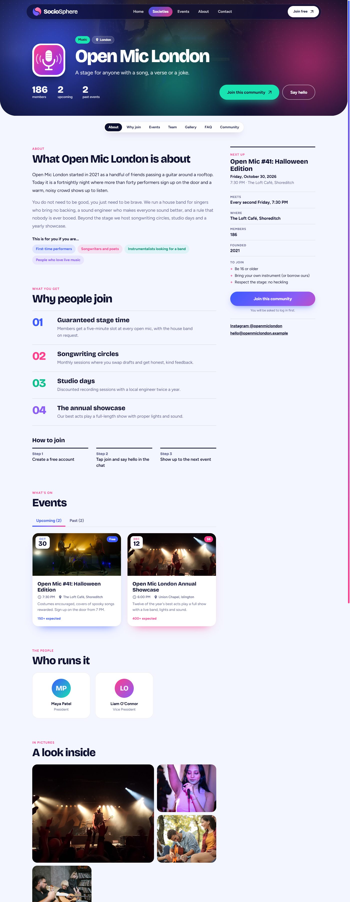
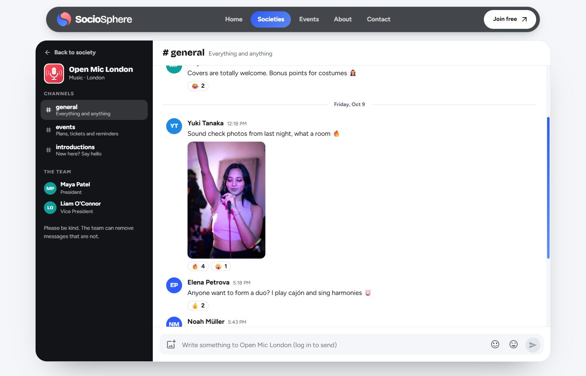

# SocioSphere

A place to find communities and see what they are doing: clubs, societies and groups with a public page, a team, a calendar of events and an open conversation. Browsing needs no account; joining, posting and RSVPing do.



| Society page | Community chat |
| --- | --- |
|  |  |

## What it does

- **Societies**: public profile with an about section, what members get, meeting details, team, gallery, FAQ, and upcoming and past events.
- **Events**: list and calendar views, filters by category and month, an event page with agenda, venue map link, RSVP and "add to calendar" (.ics).
- **Community chat**: three channels per society. Anyone can read; logged-in users can post text, emoji, stickers and photos, and react to messages. A logged-out visitor can type a draft and is asked to log in when they send it.
- **Joining**: people apply on the society page; leaders review applications; accepted people start at the lowest rank.
- **Ranks**: every society has a ladder (President, Vice President, ...). The President promotes, demotes and removes people and renames or adds ranks, effective immediately.
- **Accounts**: JWT login, a profile with the events you are going to, your societies and applications to review.

## Who can do what

| Action | Visitor | Logged in | Member | Vice President | President |
| --- | :-: | :-: | :-: | :-: | :-: |
| Browse societies, events, chat | yes | yes | yes | yes | yes |
| Apply, RSVP, post in chat | | yes | yes | yes | yes |
| Start a society (becomes President) | | yes | yes | yes | yes |
| Create and edit that society's events | | | | yes | yes |
| Edit the application form, accept or reject applicants | | | | yes | yes |
| Promote, demote, remove people, edit ranks | | | | | yes |

Permissions are per society and enforced on the server (`backend/src/middleware/societyAccess.js`). A user with `role: "admin"` is treated as a President everywhere, for support.

## Stack

React 18, MUI, framer-motion, react-three-fiber, TanStack Query, socket.io-client. Node, Express, MongoDB (Mongoose), socket.io, JWT.

## Run it locally

You need Node 18+ and a MongoDB database.

**Backend** (`backend/.env`):

```
MONGO_URI=mongodb+srv://...
JWT_SECRET=<a long random string>
PORT=5000
REACT_APP_API_URL=http://localhost:3001   # the frontend's origin, used for CORS
```

```
cd backend
npm install
node index.js
```

**Frontend** (`frontend/.env`):

```
REACT_APP_HOST_URL=http://localhost:5000
```

```
cd frontend
npm install
PORT=3001 npm start
```

The frontend must run on the origin set in `REACT_APP_API_URL`, otherwise requests are blocked by CORS.


